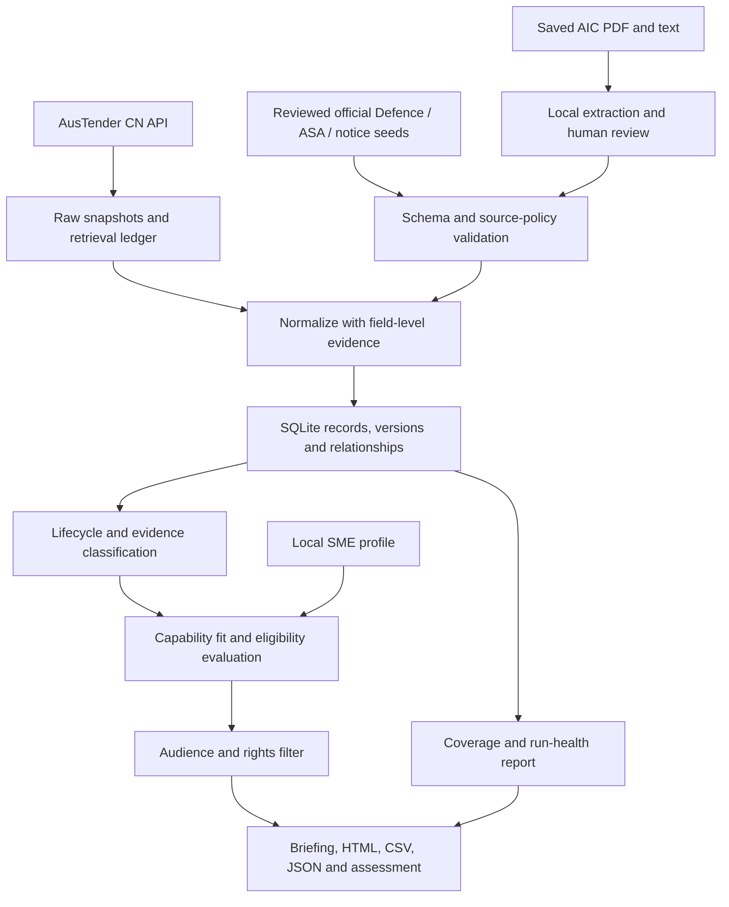

# Henderson Defence Supply-Chain Radar — v1 implementation plan

Prepared: **22 November 2026, Australia/Perth**. Research baseline: [RESEARCH.md](RESEARCH.md), commit `23559ae`. This is a design and acceptance plan; no application code is included in this documentation phase.

## 1. Product boundary and acceptance target

Build a local Python tool for a Henderson marine SME to answer: what work fits, what is open versus forward scope versus speculation, what is known about eligibility and timing, and where to take the next official action. Produce a weekly filtered briefing, a searchable work-package list with machine-readable exports, and a printable one-page capability assessment.

The implemented v1 must use **real public source data** where access and use are established, while remaining completely testable without a network. It must work with the existing saved samples and later refresh contract context from the actual AusTender API. It must never manufacture an open opportunity to make a demonstration look populated.

Research imposes these boundaries:

- AusTender OCDS is the verified **contract-notice** input. There is no verified ATM/APP API, so current tenders and procurement plans enter through reviewed official records or a separately verified, permitted export. No guessed endpoints.
- Local AIC extraction creates reviewable evidence and scope candidates. Existing-supplier tables are context. A plan's future-scope list is not an open procurement.
- Defence/ASA seeds require content, route and rights review. A discovered link is initially a disabled review candidate. Public distribution of AIC-derived material remains conditional on a documented lawful basis; a local build does not resolve that issue.
- WA.gov.au is excluded from automated ingestion under the researched terms. The WA capability directory stays outside the data model and ingestion pipeline; qualitative research is its only permitted project use.
- ICN is a destination for official engagement and competitor research, not a crawler target or an assumed free data API. No paid APIs, data subscriptions or model inference are needed at runtime.
- No application submission, automatic email, user-account automation or hosted service is required. Users follow the official application route themselves.

The first credible delivery may have no confirmed-open matches. It should still show useful permitted future scope and separately labelled contract context, with coverage gaps and unknowns. A successful local pilot is distinct from permission to launch a public/commercial content service.

## 2. Architecture and dependencies

Use **Python 3.11+**, a single local process and SQLite. The core has no required third-party Python dependencies: `argparse`, `dataclasses`, `enum`, `json`, `sqlite3`, `urllib`, `hashlib`, `pathlib`, `datetime`, `zoneinfo`, `decimal`, `csv`, `html`, `re`, `logging` and `unittest` are sufficient. Avoid a web framework, pandas, a vector database and an LLM service.

Use existing `.txt` extractions first. Optional PDF extraction invokes installed Poppler `pdftotext -layout` locally, through an argument list with a timeout and no shell expansion. Record its version. A machine without that executable can ingest supplied text and run the full default test suite. No scanned-document OCR is required for the four samples; unreadable/scanned PDFs enter a review queue. A later PDF-library fallback needs its own justified dependency decision.

Timezone data must be available for `Australia/Perth` and source zones. Prefer the host zoneinfo database; if absent, document installation of system tzdata or an optional pinned `tzdata` package. Fail clearly rather than guessing timezones. Do not use a fixed east-coast UTC offset in place of daylight-saving-aware conversion.



Inject the HTTP transport, clock, sleeper, repository and filesystem/output location at the module boundaries. Parsing, classification, eligibility evaluation, matching and rendering must be pure or deterministic functions of supplied inputs. Importing modules, parsing CLI help, reading local profiles and rendering must never open a network connection.

### Planned repository layout

```text
RESEARCH.md
PLAN.md
README.md                           setup, limitations, commands, operator guide
pyproject.toml                      package metadata; no runtime dependencies by default
defence_radar/
  __init__.py
  __main__.py
  cli.py                            argument parsing and command orchestration
  models.py                         validated record types and enums
  config.py                         JSON config/profile loading and validation
  policy.py                         allowed access and publication modes
  evidence.py                       snapshots, hashes, field references, attribution
  storage.py                        SQLite transactions, versions and checkpoints
  http_client.py                    bounded GET transport and access enforcement
  ingest/
    austender.py                    date windows, pagination and CN normalization
    aic.py                          local extraction and reviewed scope import
    seeds.py                        curated official records; no general web scraper
  classify.py                       evidence rules, lifecycle, dates and freshness
  match.py                          capability scoring and eligibility comparison
  pipeline.py                       reproducible offline build and coverage report
  render/
    briefing.py                     weekly Markdown
    exports.py                      CSV and JSON
    html_list.py                    searchable self-contained list
    assessment.py                   one-page Markdown/print HTML
    assets/                         small local CSS and JavaScript only
config/
  sources.json                      access/rights registry, including disabled sources
  taxonomy.json                     versioned tags, aliases, exclusions and weights
  aic_manifest.json                 URLs, file hashes, dates, extraction/review state
  official_seeds.json               permission-reviewed facts and candidate links
examples/
  sme_profile.json                  explicitly fictional profile
tests/
  fixtures/austender/               small attributed, reduced CC-licensed samples
  fixtures/synthetic/               original edge cases, including AIC-like layouts
  test_*.py
data/raw/                           existing gitignored evidence, never overwritten
data/cache/                         gitignored derived text and staging files
data/radar.sqlite3                  gitignored state and audit history
data/profiles/                      gitignored real business profiles
data/review/                        gitignored restricted drafts and evidence notes
out/                               gitignored generated deliverables and manifests
```

This is a proposed layout, not a list of files created in this session. Extend `.gitignore` in M1 for SQLite sidecars, real profiles, review material and `out/`; never commit raw dumps or real SME profiles. Track only source configuration and seed facts whose publication is permitted. Keep restricted material in ignored review storage and reference it by local evidence ID.

## 3. Data model and storage

Use JSON configuration with explicit validation rather than introducing YAML or a schema framework. Reject unknown enum values and missing critical provenance with actionable field-path errors. Preserve unknown *source* fields in the raw snapshot so schema drift does not discard evidence. Version the normalized schema and taxonomy independently.

### 3.1 Opportunity record

`Opportunity` is the common normalized record; `record_kind` prevents context from masquerading as work available to bid. A future AIC scope becomes one record per coherent capability/activity/route, not one invented tender per keyword.

| Field/group | Required meaning and constraints |
| --- | --- |
| `schema_version`, `id`, `source_ids`, `source_record_id` | Stable internal ID and preserved official identifiers. CN identity uses source/official contract identity; releases retain `(ocid, release_id)`. Reviewed seeds have persistent editor-assigned IDs. AIC scope IDs use a manifest document ID plus a stable reviewed scope key, not a line number or mutable title. |
| `record_kind` | `procurement`, `planned_scope`, `hypothesis`, `contract_context`, `registration_context`, `readiness_context`. A grant/event is readiness context unless deliberately added to a separate product later. |
| `title`, `summary`, `programme`, `buyer`, `prime` | Independently written scope summary where permitted; preserve agency/prime identifiers. Mark analyst-written versus publisher-stated fields. Never extract programme identity from a supplier address. |
| `status_class` | `confirmed_open`, `published_future_scope`, `speculative`, or `null`. The three non-null values are the required public alert classes. Null is mandatory for pure context and for records held without adequate classification evidence. |
| `lifecycle`, `review_state`, `publication_state` | Lifecycle: `open`, `planned`, `ongoing_scope`, `closed`, `awarded`, `cancelled`, `superseded`, `unknown`. Review: `pending`, `reviewed`, `needs_review`. Publication: `publishable`, `held`, `context_only`. Preserve classification history; a closed record must no longer have current `confirmed_open` status. |
| `classification_evidence`, `rule_ids`, `conditions` | Evidence references and versioned rule explanations. Conditions such as commercial viability or tasking-statement award remain attached. No naked enum without a reason. |
| `procurement_stage` | RFT/RFQ/specific procurement EOI/other verified stage/unknown. Newsletter interest is `registration_context`, regardless of a portal's Open badge. |
| `locations` | Place/region, role (`worksite`, `delivery`, `supplier_address`), evidence ID and confidence. Only work/delivery locations inform geographic matching. Preserve unknown and national-supply possibilities. |
| `capabilities`, `activities`, `keywords_evidence` | Normalized tag IDs with scope evidence; activities such as manufacture/supply/install/repair/inspect. Core/supporting tags are reviewer/rule decisions with recorded reasons. |
| `eligibility` | List of conditions with text/factual summary, required/preferred/unknown strength, evidence and verification date. Overall source completeness is explicit. Never equate relevance with supplier approval. |
| `close_at_utc`, `close_raw`, `close_zone`, `close_precision` | Nullable exact timestamp, original wording/offset, IANA zone if established, precision (`instant`, `date_only`, `range`, `ongoing_explicit`, `not_published`, `not_applicable`). Only an exact future instant or verified ongoing intake can satisfy the open gate. |
| `forecast_period`, `contract_period` | Separate optional ranges with original precision. Contract end and forecast quarters must never populate the close timestamp. |
| `application_route` | Purpose (`submit`, `procurement_eoi`, `register_interest`, `enquire`, `none_published`), exact authoritative URL and/or email, source-provided instructions, account requirement (`yes`, `no`, `unknown`), verification and evidence. Future records may have no application route and a separate enquiry route. |
| `source_published_at`, `source_modified_at`, `first_seen_at`, `last_seen_at`, `verified_at` | Separate nullable times with precision and provenance. HTTP Last-Modified is retained as such; it cannot silently become the document issue date. Re-reading a local file does not refresh verification. |
| `freshness_state`, `last_verification_attempt`, `verification_error` | Fresh/stale/unknown plus failed-attempt metadata. An access error is not a closure or a successful refresh. |
| `sources` | One or more evidence references with URL, notice/document ID, page/section/line or JSON Pointer, snapshot hash, access time, source date and relation (`supports`, `conflicts`, `supersedes`). |
| `rights`, `attribution` | Source policy IDs plus any document/field-level overrides; intended permitted output mode and evidence. A summary field is not automatically licensed because another source is CC BY. |
| `related_record_ids`, `supersedes_id` | Explicit relationships among plans, notices, contracts and versions. Title resemblance alone cannot close, merge or supersede a record. |
| `value_context` | Optional raw amount, decimal amount, currency and meaning. No inference that a prime contract value is available subcontract spend. Not required for relevance scoring. |

`MatchResult` is separate: profile ID/version, opportunity ID/version, score components, matching evidence, missing capabilities, exclusions and eligibility assessment. This allows the same opportunity to have different relevance for different firms without rewriting the underlying facts.

Eligibility comparison returns `meets_known_requirements`, `does_not_meet`, or `unknown`, plus individual passed/failed/unknown requirements. “Meets known requirements” must always carry any completeness limitation and must never render as official approval. An expired credential cannot count as current evidence. Profile details are user-supplied, not independently certified.

### 3.2 Source registry, snapshots and runs

- **SourcePolicy:** exact permitted host/path or local manifest; access mode (`api`, `local_only`, `manual_reference`, `disabled`); authentication mode; licence/terms URLs and review date; rights status (`licensed`, `permission_documented`, `restricted`, `unverified`); allowed purposes/audiences; robots/access notes; cadence and retry policy. Unknown permissions default to held for distribution. Changing a policy requires evidence and an audit entry.
- **Snapshot:** source ID, requested/final URL, client retrieval time, HTTP status, selected non-secret headers, content type, SHA-256, local path, publisher licence claim and extraction metadata. Keep cookies/authorization headers out of committed fixtures and user-facing logs.
- **Run/Window:** source, requested UTC interval, query field, started/finished times, pages/records, complete/partial/failed state, errors, retry details, checkpoint and last successful refresh. A coverage report must distinguish “zero matches” from “source not refreshed.”
- **Review:** reviewer, timestamp, record/content hash, decisions and evidence; an unchanged seed imported again retains its old review date. Material content changes invalidate affected field reviews.
- **BuildManifest:** audience/profile hash, taxonomy/rule versions, effective `as_of`, reporting period, input snapshots, excluded/held counts and output file hashes. Do not expose private filesystem paths in distributable outputs.

SQLite stores immutable release/snapshot references, normalized record versions, relationships, reviews, completed windows and build manifests. Prefer foreign keys and small versioned migrations. Store raw JSON for releases separately from derived display fields. Upsert release identity idempotently; if the same identity arrives with a different payload hash, retain the discrepancy and require a controlled update rather than silently losing history.

Amendments belong to their official contract/process identity; preserve identifiers verbatim. Choose a current normalized version only with supported event ordering, and flag conflicting equal-time versions. Do not add every release value to estimate total spend. Source disappearance is not evidence of deletion. Use transactions for complete-window promotion and atomic temporary-file replacement for outputs.

## 4. Ingestion design

### 4.1 AusTender OCDS contract notices

Implement only the verified endpoints documented in [RESEARCH.md, section 3](RESEARCH.md#3-austender-a-supported-route-and-its-limits). Refer to the [publisher documentation](https://github.com/austender/austender-ocds-api) rather than deriving routes from OCDS's general standard.

1. **Bootstrap:** bounded recent dates through `findByDates/contractPublished/{start}/{end}`. Default operator choice: 30 days in one-day UTC windows; allow an explicit smaller interval. Do not download historical years by default.
2. **Incremental refresh:** `findByDates/contractLastModified/{start}/{end}`, starting seven days before the last completed high-water mark and ending at the requested current instant. On first use require an explicit bounded start. Maintain a checkpoint per query stream. Overlap handles uncertain boundary inclusion and ordinary late changes; a monthly bounded 90-day reconciliation is an operator policy, not a completeness guarantee.
3. **Pagination:** follow each returned `links.next` exactly after validating HTTPS, the `api.tenders.gov.au` host and expected query-path/window. Preserve cursor query parameters. Validate redirect targets before following them. Detect repeated next URLs and missing/invalid release arrays. A configurable page cap aborts the window as incomplete; it does not count as success.
4. **Completion:** stage all page snapshots and records for a window. Promote records and checkpoint atomically only when the chain ends successfully. A multi-window run can retain earlier completed windows while flagging the remaining interval incomplete. On retry, replay the failed window from its start and deduplicate; do not assume an old cursor remains valid.
5. **Transport:** serial GETs, descriptive user agent, default two-second minimum gap, 30-second timeout, response-size bound and at most three attempts for retryable errors. Honour `Retry-After`; if the requested delay exceeds the run's wait budget, defer and report failure instead of hammering the endpoint. Do not retry 403 in a loop or bypass it. Limits are conservative client settings, not publisher promises.
6. **Parsing:** validate a JSON package and extract `releases`. Read agencies from party roles with a documented fallback if future samples use `buyer`; collect contract descriptions, UNSPSC values and original identifiers. Preserve new fields. CN and amendment tags become `contract_context`, never a current tender because a nested status says active/open.
7. **Provenance:** record the package licence and precise JSON Pointers for extracted facts. When using `findById`, join to established source/date-package licence evidence where available; otherwise mark the missing declaration. No N+1 call for every CN.
8. **Filtering:** keep a normalized context index for relevant agency/programme/marine scope. Defence or ASA as buyer is a candidate filter, not evidence of capability fit. Non-Defence marine work is out of the initial scope unless explicitly curated as relevant. Keep count/coverage statistics for excluded records without dumping unrelated contacts into outputs.

The saved 20 November query has **another next page after page two**. Treat it as an intentionally incomplete chain in local verification. The saved 1 October response has 93 releases and no next link. Tests must exercise both cases and may use labelled synthetic terminal pages, never present a stitched test chain as a real complete API response.

### 4.2 Local AIC extraction and review

`aic_manifest.json` identifies the four saved PDFs and `.txt` counterparts, official URLs, SHA-256s, issue/revision information, index/server dates, rights state and extraction version. Preserve form-feed page boundaries and source-specific quirks.

The extractor returns document text plus page references, extraction warnings and candidate sections (scope, future opportunities, engagement). It must **not** auto-publish table rows. A reviewer supplies a small structured set of scope records with stable IDs, capability/activity tags, status evidence, condition text and enquiry/registration routes. The raw supplier table stays local.

Required sample distinctions:

- RMP-West: local maintenance categories are scope; the Babcock email is an enquiry/registration route, not a bid deadline.
- Hunter: existing supplier rows remain context, separately from future systems scope; worksite is Osborne unless another scope says otherwise.
- Austal: enabling MSTS work and anticipated LCM/LCH trade scope are distinct; some sourcing is already decided. Keep the contradictory AIA cell as a warning.
- LM2500: higher-level domestic maintenance is conditional; preserve the malformed primary email and use no invented correction. An unambiguous alternative remains an enquiry route only.

For current fixtures, local extraction can proceed for the permitted research purpose. Distributable AIC text/derived summaries stay held unless their rights policy records an adequate basis. Internal/public output settings must enforce documented purposes rather than treat “internal” as an automatic exemption.

### 4.3 Curated official seeds and future APP/ATM imports

Use a small JSON seed file, not web-page scraping. A source entry contains: stable ID, canonical official URL, source family, content/review state, factual scope or a review-candidate label, status evidence, publication/verification dates, eligibility, close wording/zone/precision, route purpose, document/notice references, related records and rights evidence. Do not use an unrestricted `status_override` to bypass the classifier.

Initial source references are the saved AIC index and ASA industry hub, plus the exact Henderson/SRF-West/readiness links found there. Unread destination pages enter as disabled `manual_reference` candidates. They produce no opportunity until reviewed. Missing eligibility/close/route fields remain explicit unknowns, not plausible defaults.

An operator may add an official ATM/APP after reviewing the accessible official notice and its terms. An authenticated user's ability to read a notice is not permission to republish its documents. A new official CSV/export adapter is a **later conditional extension**, requiring an actual permitted sample, schema mapping and offline fixtures. It is not a dependency of M1–M10. RSS and automated AusTender HTML ingestion remain disabled.

For pages without an API, v1 review is manual and bounded. Future authorized change detection must check robots/terms, cache responses, restrict paths and preserve licences; it must not grow into a general crawler. No automatic WA/ICN/directory fetcher is part of this plan.

## 5. Classification, lifecycle and matching

### Classification order and invariants

Implement the research rules as versioned deterministic decisions with human-readable explanations:

1. Determine `record_kind`; isolate awarded contracts, registrations and readiness information.
2. Evaluate cancellation, supersession, explicit award/closure and close-time expiry. If `as_of >= close_at_utc`, it is no longer open. Preserve the last positive evidence in history.
3. Require actual procurement scope, express current intake, a verified submission route, exact future close time or explicit ongoing intake, and verification no older than 24 hours for `confirmed_open`. A masked or date-only deadline requires review. A known future opening date is future scope, not open.
4. Otherwise use `published_future_scope` only for publisher-stated planned/ongoing supply-chain scope. Track source date and a 30-day review policy; overdue forecasts require review, not silent promotion or guessed dates.
5. Use `speculative` only for a reviewed, grounded analyst hypothesis with stated missing evidence; expire/review after 30 days. Keep it off the default actionable shortlist.
6. If evidence is incomplete/conflicting, retain the record as held/needs-review with a null current class. Insufficient evidence does not automatically become speculative. Apply audience/rights restrictions independently of factual classification.

Freshness is based on an authoritative content/status verification, not ingestion time. Reusing a saved PDF or replaying an API fixture does not prove present opportunity status. A failed retrieval preserves prior facts and records the error; it cannot renew freshness. A later cancellation or contradictory notice requires reconciliation by official identity and source authority, not whichever generic page happened to be fetched last.

Treat eligibility, classification and relevance as separate axes. An open notice with missing eligibility details can still be open if the other evidence is complete, but it must show eligibility unknown. A firm failing an explicit mandatory condition is excluded from its actionable shortlist while the underlying open record remains visible with the failed condition if requested.

### Capability profile and explainable score

The user supplies a local profile: capabilities/subtags, activities, materials/processes, equipment limits, workshop/mobile service, locations and travel/supply reach, relevant experience, current certifications/approvals with dates, capacity and exclusions. Required personal data is minimal; credentials/secrets are not stored. Use a fictional example profile for documentation and tests.

Start with the 14 capability keys in [RESEARCH.md, section 5](RESEARCH.md#5-practical-capability-taxonomy). Normalize case, punctuation and a controlled alias dictionary with word/phrase boundaries. Record which scope span caused each tag. Negations, existing-supplier sections and general programme descriptions must not trigger strong matches. Alias repetition cannot multiply the score. Ambiguous terms such as hydraulic, electrical and maintenance require their marine/system/activity context.

Proposed initial score, an explainable ranking heuristic rather than a probability:

| Component | Points | Rule |
| --- | ---: | --- |
| Capability coverage | 0–60 | Weighted intersection of evidenced opportunity tags and profile capabilities, divided by total evidenced opportunity-tag weight. Core tag weight 2, supporting tag weight 1; tag role is recorded. A related broad tag receives no exact-match credit without a documented mapping. |
| Activity fit | 0–20 | 20 for an explicit matching activity such as repair versus supply; 10 only for a reviewed compatible activity; 0 for unknown. A known incompatible activity excludes the match from the shortlist. |
| Delivery fit | 0–15 | 15 for evidenced work within the profile's declared service area; 8 for explicit offsite/national supply the firm can deliver; 0 if unknown. A supplier address adds no points. Known inability to deliver excludes the shortlist match. |
| Scope specificity | 0–5 | 5 where a concrete system/task supports the match; 0 for generic programme language. Show the evidence and avoid duplicating alias counts. |

If no capability intersects, score is zero regardless of location. Suggested display bands are high relevance (70–100), review (40–69), weak (1–39), and unmatched (0); calibrate these on reviewed cases. Unknowns remain visible instead of receiving optimistic points. Do not add deadline urgency or an “open” bonus to capability fit: sort by class/lifecycle first, then fit and deadline within the class. Eligibility failures and publication restrictions cannot be overcome by a high score.

For each result show component values, matched capabilities/evidence, missing capabilities, geographic rationale and the separate eligibility result. Record rule/taxonomy versions and profile hash for reproducibility. No learning or keyword expansion from the WA directory's company profiles is permitted.

### Duplicate and change handling

Deduplicate exact source identities and release hashes first. Cross-source title similarity can suggest a human-reviewed relationship, not an automatic merge. A programme can contain many packages and a plan can describe both existing and future work. Keep those records separate and group by programme only for presentation.

Record material changes to class, lifecycle, close time, route, scope and conditions. A newer HTTP timestamp without changed content is not a new opportunity. Reclassification after a deadline must happen on an offline build even if no ingest ran. An exact linked award can retire the corresponding notice; a similar contract description cannot.

## 6. Outputs and publication policy

Write a complete build to a temporary directory, validate its artifacts, then replace the selected output directory atomically where supported. A failed build must leave the last successful output intact. Separate profile/audience/reporting-period directories prevent a research build from overwriting a distributable briefing. All generated files stay in `out/` and outside git.

| Artifact | Required content and behavior |
| --- | --- |
| `briefing-YYYY-MM-DD.md` | Reporting period and effective AWST time; concise coverage/refresh note; matched confirmed-open items; published future scope; optional speculative watch; separate relevant contract context; new/materially changed/closed items; next actions and attribution. Every alert includes status, eligibility/unknowns, deadline or explicit absence, route purpose and source. Say when no open matches are verified. |
| `work-packages.json` | Versioned export envelope with build/source metadata and complete permitted record/match fields, typed nulls and explicit date precision. Keep context records identifiable and outside the default active-opportunity subset. |
| `work-packages.csv` | One record per row with stable ID, kind, class, lifecycle, title, programme, capabilities, fit/eligibility, close fields, location, route type/link, source links/IDs, verification time and conditions. Use documented delimiters for lists; JSON retains richer evidence. Include a schema/attribution note. |
| `work-packages.html` | Self-contained searchable/sortable list with text search and filters for capability, class, lifecycle, geography and eligibility; default view excludes context, expired and speculative items. Display result counts, badges with text, unknowns and sources. Inline/local CSS/JS only, no CDN, analytics or external fetch. Works from `file://` with data embedded safely; basic table remains usable without JavaScript. |
| `assessment-<profile>.md` and `.html` | One-page assessment of the firm's strongest relevant matches, known constraints, readiness gaps and official next actions. Show at most three records, with status and evidence; if none match, say so and identify missing profile/evidence. HTML has an A4 print stylesheet; text target about 400–450 words. A shortlist is not a guarantee of qualification or work. |
| `manifest.json` and `coverage.json` | Reproducible input/output hashes, policy/rule versions, source health, partial windows, reviewed/held/excluded counts, stale evidence and missing APP/ATM coverage. Public versions contain no private local paths or sensitive profile fields. |

The one-page assessment selects from the relevant evidence without padding it with speculative possibilities. Use compact source captions/IDs with clickable official links and full details in the accompanying list; preserve meaningful conditions even when that means showing fewer matches. Acceptance includes A4 print-preview inspection for no clipping or second page, not merely a word-count assertion.

Escape all source/profile text in HTML; insert text through safe DOM APIs, never untrusted HTML. Restrict output link schemes to expected `https`, original reviewed `http` routes and valid `mailto`; flag unverified legacy routes. Do not auto-follow user-supplied links. Defend spreadsheet exports against formula execution in leading `=`, `+`, `-`, `@` and control-character cases, documenting the display escaping while preserving originals in JSON. Validate output path names and never derive filesystem paths directly from source titles.

### Rights and audience filter

`research` builds are local evaluation artifacts with restricted material confined to its documented permitted purpose. `public` builds include only records/fields with an established distribution basis and appropriate attribution. Both modes require a source policy; neither accepts an “ignore rights” switch. Unknown/restricted material is held and counted in coverage, without leaking the excluded text through titles, snippets or assessment explanations.

For mixed-source records, apply rights at field level or withhold the record; adding a licensed CN citation cannot authorize copied AIC content. Every derivative/export includes required licence links and transformation notices. A manually authored fact summary still needs an appropriate basis. Profiles remain private by default; public assessments require intentional selection of fields suitable for distribution.

### Weekly deltas and reproducibility

Use an explicit `as_of` instant and reporting period; do not let module-level wall clocks alter classifications. Weekly deltas compare the current period with the last successful **earlier distinct period** for the same profile/audience. Rebuilding the same period with identical inputs uses the same baseline and produces identical substantive output bytes, including the recorded effective time.

Keep source-event date, discovery date and verification date visible so a newly discovered old plan is not described as newly announced. Refuse a historical `as_of` earlier than required evidence unless an appropriate historical snapshot exists; fixtures can supply their own deterministic replay clock. A source failure displays stale/partial coverage, while expired exact deadlines are still evaluated locally.

## 7. Proposed CLI and operator workflow

These commands are **planned interfaces**, not commands available in this documentation-only repository. Use `python -m defence_radar` without a packaging/install requirement during development. Common options include `--db`, `--as-of`, `--offline` and structured logging. Paths default inside this project.

| Command | Purpose / network behavior |
| --- | --- |
| `python -m defence_radar init` | Create local schema/directories and validate config; no network. |
| `python -m defence_radar sources check --offline` | Show source permission/access state, disabled inputs and missing local files; no network. Does not claim to recheck remote terms. |
| `python -m defence_radar ingest austender --field contractPublished --start 2026-10-01T00:00:00Z --end 2026-10-02T00:00:00Z` | Explicit online bootstrap using verified date queries and all pages. |
| `python -m defence_radar ingest austender --field contractLastModified --incremental` | Explicit online incremental refresh from a completed checkpoint plus configured overlap. Initial use without a checkpoint needs explicit dates. |
| `python -m defence_radar ingest austender --saved-dir data/raw/2026-11-22 --offline` | Replay saved packages with their metadata; flag incomplete modified-query coverage and never advance a live-fetch checkpoint. |
| `python -m defence_radar ingest aic --manifest config/aic_manifest.json --offline` | Read saved text and reviewed scope decisions; optional `--extract-pdf` invokes local Poppler. Importing is not content approval. |
| `python -m defence_radar ingest seeds --file config/official_seeds.json --offline` | Validate/import reviewed official records and disabled candidate links; no page fetch. |
| `python -m defence_radar profile validate data/profiles/company.json` | Check taxonomy keys, dates, delivery areas and private/public fields; no network. |
| `python -m defence_radar inspect <record-id> --as-of 2026-11-22T20:00:00+08:00 --offline` | Explain raw-to-normalized evidence, lifecycle/class, rights and optional profile match. Restrict sensitive diagnostics to local use. |
| `python -m defence_radar build --profile data/profiles/company.json --week-ending 2026-11-22 --as-of 2026-11-22T20:00:00+08:00 --audience research --out out/company/2026-11-22 --offline` | Classify, match and produce all outputs from local state; no network. Only permitted research content is included. `--audience public` applies the distribution gate. |
| `python -m defence_radar audit --offline` | Report integrity, expired/stale records, incomplete runs, held content and attribution/route problems; no network. |
| `python -m unittest discover -s tests` | Run default offline suite using committed fixtures only. |

`--offline` rejects any attempted remote request, including implicit schema/extension lookup. A local replay cannot overwrite a live checkpoint or renew `verified_at`. Exit codes should distinguish success, bad input/policy failure and partial/failed ingestion. A completed build may still report expected source limitations; a separate `--strict` option can fail scheduled publication when required sources are stale/incomplete. Never suppress that warning just to return zero.

Suggested operation after the build is accepted:

1. Daily serial CN refresh, with logged source health. Keep the requested end time and checkpoint in UTC.
2. Weekly manual source/seed review, followed by local build and review of the briefing/assessment. Any confirmed-open record requires the 24-hour verification gate.
3. Monthly bounded CN reconciliation plus source-policy, taxonomy and document-version review.
4. Use the user's local scheduler/cron only when requested during implementation. Scheduling and sending notifications are not part of this documentation session or automatic delivery behavior.

## 8. Verification strategy

Default tests must pass on a clean checkout without network, existing `data/raw`, real profiles or Poppler. Inject a fake HTTP transport and disable sockets for the test process so accidental networking fails loudly. Test time is explicit. Runtime optional integrations get local contract tests and an opt-in manual smoke check; no live service is required by CI.

### Fixture policy

- Derive small CN fixtures from `cn-sample.body`, `cn-last-modified.body`, `cn-last-modified-page2.body` and `cn-by-id.body`; retain source URLs, relevant licence provenance and an attribution README. Include at least a Defence CN, an amendment and the missing-licence by-ID shape. Omit unnecessary personal contact fields and mark all reductions/redactions. Do not commit large raw bodies.
- Preserve representative pagination URLs and shapes. A reduced response is labelled reduced; an invented terminal page is labelled synthetic. Test the saved page-two next link as incomplete, not terminal.
- Do not commit full AIC PDF text or supplier tables. Author original synthetic texts to exercise page boundaries, columns, registration language, conditional future scope and malformed contacts. Record expected facts/decisions from the four sample findings as concise reviewed cases where appropriate, not copied descriptions.
- Add optional offline sample checks that read the user's existing ignored files. They verify real response counts/fields and four document/route findings when available; absence gives an explicit skip. A clean default run must not pass only because everything was skipped.
- Save any new live smoke sample in ignored raw storage with metadata and hash; derive a minimized permitted fixture only if it adds a new failure case.

### Meaningful test cases

| Area | Required cases and expected outcome |
| --- | --- |
| HTTP and paging | No-next page; multiple pages; page two still has next; repeated cursor; off-host/changed-window next or redirect; 429/Retry-After; bounded 5xx retries; 403 stop; malformed JSON; response-size cap. An incomplete chain never advances its checkpoint or silently promotes partial data. |
| Storage/idempotency | Replayed/overlapping windows do not duplicate releases; changed payload under identical identity is retained/flagged; amendment versions are not double-counted; interrupted commit/build leaves last successful state; fixture replay never changes live refresh state. |
| CN normalization | Procuring entity resolved from party role; sparse descriptions preserved; contract end not close; generic agency mail not an application route; active/open nested fields cannot produce open procurement. |
| AIC/seed import | Page evidence retained; supplied issue date not confused with server Last-Modified; malformed email flagged without guessed correction; existing-supplier rows excluded from future scope; unread URL remains disabled; material edit invalidates prior review. |
| Classification/time | All three labels plus null/held context; genuine specific procurement EOI; Keep Me Updated registration trap; past/exactly-expired closes; future opening; explicit ongoing intake; date-only/masked/missing zones; AWST and east-coast daylight saving; cancellation, staleness and conflicting evidence. |
| Eligibility | Known required criterion met/failed/unknown; expired credential; preferred criterion not a hard exclusion; no requirements published is unknown completeness, not universal eligibility. |
| Matching | Known relevant RMP-West-style hydraulic scope outranks generic electronics for a hydraulic SME; machining is not inferred solely from component repair; supplier address yields no local points; repair versus new-equipment supply distinction; repeated aliases do not inflate score; missing capability forces zero. |
| Outputs and rights | Required fields/unknowns in each format; no open/context count confusion; public exclusion of restricted fields including derived explanations; correct licence provenance; HTML escaping and CSV formula defence; offline file-based search/filter behavior; one-page print preview and readable narrow-screen table. |
| End-to-end | Fake-clock ingest/replay → normalize → classify → match → all artifacts using a fictional profile. Same inputs/period give stable output hashes; changing a real deadline or condition changes the affected record/delta. Zero confirmed-open output is a valid scenario. |

Use table-driven tests for decision rules and selected artifact snapshots for user-visible contracts. Avoid brittle full-HTML snapshots or tests that simply restate every implementation line. Run focused checks for each milestone and the complete suite at integration/release; broaden only for new behavior or failures. Perform one bounded real API smoke run near completion, preserving failures honestly, rather than repeated network probing.

## 9. Milestones, model allocation and acceptance criteria

Each milestone is a small reviewable commit on the authorised project branch, followed by the owner's requested push. Builders must stay inside this repository and must not touch the neighbouring radar projects. Routine work uses **gpt-6-luna, medium**. Assign **gpt-6-astra** to the difficult pagination/state, classification and matching logic. The top-tier orchestrator retains source-policy, legal-scope, product and acceptance judgments and verifies delegated results before committing.

These are future build assignments, not permission to write code in the present documentation session. Do not concurrently edit shared model/config files across builders. Complete dependencies in sequence; a larger-than-expected milestone should be split into an implementation commit and a focused validation commit rather than bundled into an unreviewable change.

| Milestone | Deliverable / dependencies | Builder tier | Acceptance criteria |
| --- | --- | --- | --- |
| **M1 — Local skeleton and schema** | Package/CLI help, typed records, config/profile validation, fixture structure, privacy-related ignore rules. Depends on this plan. | **gpt-6-luna, medium**; orchestrator reviews schema/policy enums. | CLI help and import do no I/O beyond local config; invalid required fields/enums fail clearly; fictional profile works; real profiles/state/output/raw remain ignored; zero application network dependency. |
| **M2 — Evidence and persistence** | SQLite migrations, immutable snapshot/release refs, reviewed record versions, source policy and run/checkpoint storage. Depends M1. | **gpt-6-luna, medium**; orchestrator reviews rights/provenance behavior. | Replay is idempotent; conflicting payload identity is retained/flagged; transactions recover after interruption; policy/audience state cannot silently default to permission; no secrets in public diagnostics. |
| **M3 — AusTender adapter** | Date-window bootstrap/incremental pull, transport bounds, pagination, CN normalization, offline replay. Depends M2. | **gpt-6-astra**. | Reduced real fixtures parse; party-role buyer mapping works; all supplied pages followed; incomplete/loop/429/403/foreign-next cases behave as specified; checkpoint only after complete chain; contract end/status never becomes open tender data; by-ID licence omission retained. |
| **M4 — Local AIC and official seeds** | Text/optional PDF ingestion, four-document manifest, reviewed-scope workflow and seed importer. Depends M2. | **gpt-6-luna, medium**; orchestrator reviews every real scope and publication basis. | Works without Poppler using supplied text; page refs/conditions preserved; Hunter incumbents and RMP scope separated; Austal registration not procurement; GE email defect flagged; unreviewed links/rights remain held; no directory/WA/ICN crawler. |
| **M5 — Status, time and eligibility** | Pure classification engine, lifecycle transitions, freshness and requirement comparison. Depends M3–M4. | **gpt-6-astra**. | All class/lifecycle invariants pass, including exact deadline boundary, ambiguous timezone, stale open record, cancellation, future/ongoing scope and registration; mandatory failure/unknown eligibility cannot be erased by relevance; traceable rule/evidence reasons. |
| **M6 — Capability matching** | Versioned 14-category taxonomy, profile parser integration, component score, exclusions and explanations. Depends M5. | **gpt-6-astra**. | Reviewed positive/negative examples rank sensibly; no capability yields zero; generic electronics and supplier geography do not create false Henderson matches; alias repetition bounded; score breakdown is reproducible and eligibility remains separate. |
| **M7 — Briefing and data exports** | Weekly Markdown, CSV/JSON schema, delta baseline and audience filter. Depends M6. | **gpt-6-luna, medium**; orchestrator reviews actual content. | All alerts have five essential fields (status, eligibility, close, route, sources); explicit zero-open/partial-source output; public rights gate covers derived fields; attribution correct; CSV safe; same-period rebuild stable. |
| **M8 — Search and one-page assessment** | Self-contained HTML list and printable assessment Markdown/HTML. Depends M7. | **gpt-6-luna, medium**. | File-based search, filters and sorting work without requests; defaults exclude inactive/context/speculation; unsafe text escaped; keyboard-readable controls; assessment fits one A4 page without clipping, shows evidence/unknowns and handles no matches. |
| **M9 — Complete CLI and operating guide** | Wire full local pipeline, atomic outputs, coverage/audit manifests, README, optional scheduler example and end-to-end tests. Depends M3–M8. | **gpt-6-luna, medium**; orchestrator reviews failure semantics. | A clean checkout can run default tests and fixture demo entirely offline; optional real-sample checks have explicit skips; failed refresh preserves outputs/checkpoint; documented commands, exit statuses and source limitations agree with behavior. No scheduler or notification is activated automatically. |
| **M10 — Real-data acceptance and pilot handoff** | Bounded live CN smoke, local four-sample check, reviewed seed/profile run and final evidence audit. Depends M9. | **gpt-6-astra** for technical acceptance; top-tier orchestrator for rights and product judgments. | Full offline suite passes; successful bounded live CN refresh is evidenced or explicitly remains blocked/incomplete; all three output types generated from real permitted data; synthetic demonstrations stay in separate test outputs and never enter real briefings; permission holds and open-input gap remain visible; no public/commercial launch claim without its separate gates. |

M1/M2/M4/M7/M8/M9 should each be approximately half a day to a day of focused work; M3/M5/M6/M10 may need one to two days including review. Allow roughly **8–14 developer days** for a careful first implementation and verification, plus external rights/access work that cannot be scheduled as coding time. Weekly manual review might start at one to two hours for a small allowlist; measure it in the pilot instead of promising hands-off operation.

If the M10 live request fails, do not mark its live-data acceptance passed because fixture replay works. Ship only a transparently labelled local evaluation build, preserve the access failure and keep that acceptance item open. Similarly, complete code does not resolve withheld-content permissions.

## 10. Release gates and deferred work

A usable local v1 requires: passing offline tests; evidence-preserving real CN import; reviewed local sample handling; deterministic class/match explanations; all outputs; explicit unknowns and coverage; and no restricted/private content leakage. At least one real, bounded API run must be verified for the claim that live refresh works. A fixture demonstration alone supports only offline reproducibility.

A public or commercial release additionally requires documented rights for each distributed field, reliable verified input for any claimed current-opportunity coverage, human review of notices/routes, and user evidence that the briefing improves the existing ICN/AusTender workflow. The user may choose a narrower licensed-CN/context product while AIC permissions or live-open coverage remain unresolved; the marketing and outputs must match that narrower scope.

Defer broad web crawling, WA directory ingestion, paid feeds, automated ICN access, generic PDF table extraction, speculative retender prediction, embeddings/LLM scoring, automatic applications, email delivery, multi-user hosting and an APP/ATM export adapter without a permitted sample. Revisit only when a demonstrated need and an authorised access method justify the additional maintenance.

The implementation is complete when the accepted scope works and its limits are visible. Extra source volume is not an acceptance criterion; traceable useful evidence and correct official next actions are.
