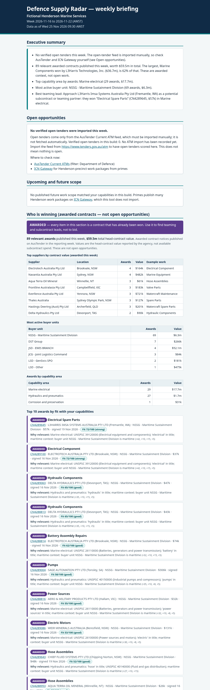
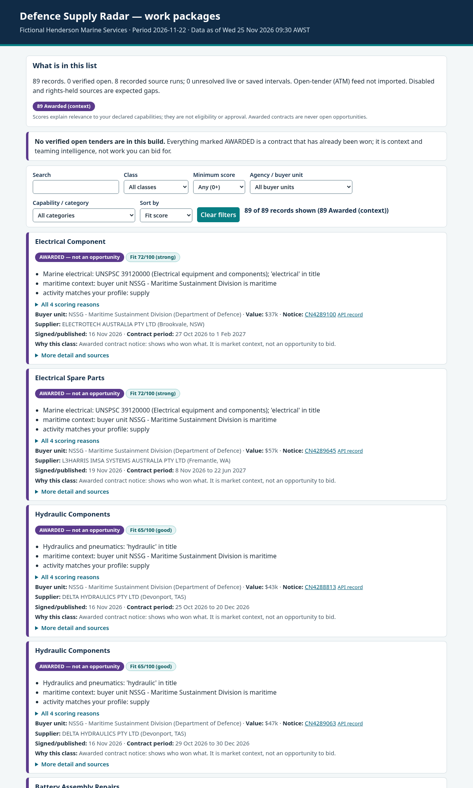
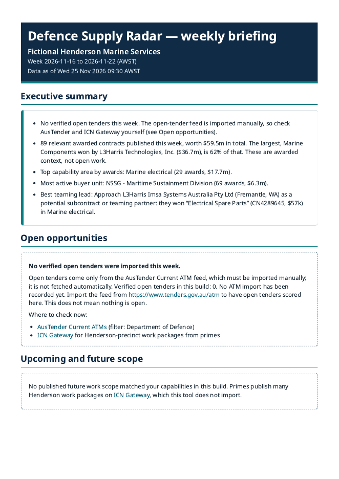

# Henderson Defence Supply-Chain Radar

A weekly, offline-first defence supply-chain briefing for a small marine engineering, fabrication and hydraulics SME near the Henderson (WA) shipbuilding precinct. It reads public AusTender data (CC BY 3.0 AU) and scores relevance to the SME's declared capabilities, with an explainable reason for every score. It keeps genuinely open tenders separate from awarded-contract market intelligence.

It supplements ICN and agency portals. It does not replace them, and it does not claim exclusive discovery, qualification or a guarantee of work.

## What you get each week

- **Briefing** (HTML, PDF and Markdown): executive summary, open opportunities, upcoming scope, who is winning (awarded), recommended actions, and coverage.
- **Work-package page**: filterable HTML, plus JSON and CSV.
- **One-page A4 assessment** (HTML and Markdown).
- **`coverage.json`**: what was and was not covered, with held sources and gaps.
- **`manifest.json`**: build time, period, profile hash, versions, snapshot hashes and artifact hashes.

## Screenshots


*The weekly briefing page.*


*Work-package page with filters and score reasons.*


*First page of the PDF briefing.*

## Sample outputs

Everything in [`out/sample/`](out/sample/):

| File | What it is |
|---|---|
| [briefing-2026-11-22.html](out/sample/briefing-2026-11-22.html) | Briefing, HTML |
| [briefing-2026-11-22.pdf](out/sample/briefing-2026-11-22.pdf) | Briefing, PDF |
| [briefing-2026-11-22.md](out/sample/briefing-2026-11-22.md) | Briefing, Markdown |
| [work-packages.html](out/sample/work-packages.html) | Filterable work packages |
| [work-packages.json](out/sample/work-packages.json) | Work packages, JSON |
| [work-packages.csv](out/sample/work-packages.csv) | Work packages, CSV |
| [assessment-fictional-henderson-marine-sme.html](out/sample/assessment-fictional-henderson-marine-sme.html) | One-page assessment, HTML |
| [assessment-fictional-henderson-marine-sme.md](out/sample/assessment-fictional-henderson-marine-sme.md) | One-page assessment, Markdown |
| [coverage.json](out/sample/coverage.json) | Coverage and gaps |
| [manifest.json](out/sample/manifest.json) | Hashes and build metadata |

The sample was generated from live AusTender contract notices for the AWST week 16-22 Nov 2026 (live refresh run 25 Nov 2026), using the fictional profile `examples/sme_profile.json`. It shows **0 open tenders**. The ATM feed could not be fetched from the build host (HTTP 403) and none was imported, so that section is honestly empty.

## Quick start

Python 3.11+ is enough at runtime (standard library only). pytest is for development tests. `--pdf` uses local headless Chrome.

```sh
python3.11 -m venv .venv
.venv/bin/python -m pip install -r requirements.txt
PATH=.venv/bin:$PATH python -m pytest -q
python -m defence_radar init
```

Weekly run. Give the AWST Monday 00:00 start as UTC (here 2026-11-15T16:00:00Z). Timestamps need a timezone.

```sh
python -m defence_radar all \
  --start 2026-11-15T16:00:00Z --end 2026-11-22T16:00:00Z \
  --profile examples/sme_profile.json --week-ending 2026-11-22 \
  --audience public --out out/live/2026-11-22 --pdf
```

Optional, to add open tenders. Save https://www.tenders.gov.au/public_data/rss/rss.xml in your own browser as `data/inbox/atm-2026-11-25.xml`, then import it and rebuild offline:

```sh
python -m defence_radar ingest atm-rss --file data/inbox/atm-2026-11-25.xml \
  --accessed-at 2026-11-25T08:00:00+08:00
python -m defence_radar build --profile examples/sme_profile.json \
  --week-ending 2026-11-22 --audience public --out out/live/2026-11-22 \
  --offline --pdf
```

Other commands:

- Incremental refresh: `python -m defence_radar fetch --field contractLastModified --incremental --end <ISO time>`. It uses the stored checkpoint with a seven-day overlap. The first incremental run needs `--start`.
- `build --strict` refuses to publish if relevant live coverage is unresolved, there has been no successful live refresh, or the last one is over seven days old.
- `python -m defence_radar inspect cn:<id> --offline` shows the evidence behind a record.
- `python -m defence_radar audit --offline` checks run completeness and integrity.
- Subcommands also include `sources check`, `profile validate`, `brief`, `assess` and `ingest austender|aic|seeds|atm-rss`. Run `python -m defence_radar <command> --help`.

Offline fixture walkthrough: `ingest austender --saved-dir tests/fixtures/austender --offline`, then `build ... --offline`. The fixture deliberately includes an incomplete page chain, so the build returns exit 3. Saved replays keep their original access times and never advance the live checkpoint.

## How relevance scoring works

Scoring is "match-2": 0-100, built from explainable components.

| Component | Max | Evidence |
|---|---|---|
| Capability | 45 | Taxonomy keywords and synonyms plus the UNSPSC family map in `config/taxonomy.json`. Negation-aware. Code-only evidence is weighted at 70%. |
| Maritime context | 15 | Marine terms, marine UNSPSC, or a maritime buyer unit (for example NSSG Maritime Sustainment Division, ASA). |
| Activity | 15 | Activities the SME declares it does. |
| Delivery / location | 15 | An evidenced worksite in the service area, or goods with national supply. A supplier's address never counts. |
| Specificity | 10 | How specific the scope is. |

Gates:

- Off-profile categories (IT, catering, legal, training, recruitment and similar) cap at 10.
- Non-maritime platforms (vehicle, aircraft, army) cap at 20.
- No maritime context caps at 50.
- A maritime signal from the buyer unit alone caps at 20.
- No capability and no maritime evidence scores 0.

Bands: **strong** 70 or more, **good** 45-69, **possible** 25-44, **low** below 25. Awarded contracts below 25 are excluded from outputs.

Example reason line: `+42 Marine electrical: UNSPSC 39120000 (Electrical equipment and components); 'electrical' in title`

Scores measure relevance. They are not eligibility or approval.

To adapt it to another SME, edit `examples/sme_profile.json`: `capabilities` (keys from `config/taxonomy.json`), `activities` and `service_regions`. Real profiles cannot overwrite `out/sample/`.

## Status classes

| Class | Meaning |
|---|---|
| `confirmed_open` | Only from a fresh (48 hours or less) AusTender current-ATM feed import, or fully verified reviewed records. |
| `published_future_scope` | Published notice of future scope. |
| `speculative` | Opt-in only (`--include-speculative`). |
| `awarded_context` | Contract notices. Market intelligence, never an opportunity. |
| `context_only` | Registrations and "keep me updated" pages. |
| `inactive` | No longer active. |
| `held` | Withheld, with a stated reason (stale feed copy, rights, unreviewed). |

Date-only, masked or ambiguous-zone deadlines cannot establish an open opportunity.

## Sources and licensing

| Source | Status |
|---|---|
| AusTender OCDS contract-notice API | CC BY 3.0 AU. Live, fetched serially, policy-checked, paginated and bounded to 90 days. |
| AusTender current-ATM RSS (`austender_atm`) | CC BY 3.0 AU per data.gov.au, updated daily after business hours. Imported manually because the host returns 403 to automated clients. Never scraped, and no bypass is attempted. Only feed fields are used. |
| AIC plans | Rights-held (Defence copyright). Local extraction is not reuse permission. Held for both public and research output. |
| ASA / manual references | Unverified unless reviewed. |
| WA tenders, ICN, directory | Disabled. WA terms forbid automated access, and ICN has no bulk licence. |

Notice links go to the public page `https://www.tenders.gov.au/Cn/Show/<guid>`. The GUID is the `awardID` suffix, verified against API data. The API record is kept as secondary provenance. Page reachability could not be checked automatically from the build host.

Details: [docs/OPEN-TENDER-SOURCE.md](docs/OPEN-TENDER-SOURCE.md) (ATM feed licence, operator workflow, freshness, rejected sources) and [docs/M10-ACCEPTANCE.md](docs/M10-ACCEPTANCE.md) (live acceptance record, the empty-window HTTP 400 fix, pilot handoff).

Source policy lives in `config/sources.json`. Reviewed seeds are in `config/official_seeds.json`, and AIC document hashes in `config/aic_manifest.json`. Recompute the record digest after any edit.

## Operations and safety

- **Network.** Online access happens only for `fetch`, `all`, `ingest ... --fetch` and `ingest austender` without `--offline`. `build`, `brief`, `assess`, `inspect`, `audit` and local imports are offline.
- **Paths.** Database, raw input and output paths must stay inside this project. Output bundles must be under `out/`. Do not put credentials or private files there.
- **Rollback-safe output.** A build is written to a sibling temporary directory, checked, then installed with a backup of the previous bundle. The baseline is saved in the same SQLite transaction. On any error the previous bundle and baseline remain intact. The PDF is not hashed in the manifest.
- **Delta baselines.** Rebuilding a profile, audience and period uses only a strictly earlier period as its baseline.
- **Manifest and coverage.** The manifest records the effective time, period, profile hash, versions, snapshot hashes, audience, held and excluded counts and artifact hashes (not its own). Coverage omits private paths and raw error strings.
- **CSV safety.** List cells use semicolons. Cells that could execute in a spreadsheet get a leading apostrophe. JSON keeps the original values.
- **Timezones.** Needs system tzdata including Australia/Perth and Australia/Sydney. The default build period is the AWST date. ATM close times are converted only when the feed says "(ACT Local Time)", treated as Australia/Sydney.
- **Optional PDF extraction** of AIC documents needs local Poppler. The default tests do not.
- **No scheduler** or background refresh is active. Add one only after separate review.

### Exit codes

| Code | Meaning |
|---|---|
| 0 | The requested operation completed. |
| 2 | Invalid input, policy or configuration. |
| 3 | Partial or failed refresh, integrity failure, or strict-coverage failure. Held AIC records also return 3. This is a signal, not an error. |

### Recovery

For exit 3, run `audit`, resolve the source gap or replay a complete saved chain, then `build --offline`. A failed window does not erase the last complete output or advance its checkpoint, though earlier completed windows may already have. If a run is interrupted during the two directory renames, a sibling `.NAME.backup-PID` holds the previous output. Restore it before rerunning if the destination is missing. The directory swap is not a cross-filesystem or power-loss transaction.

## Known limitations

- Open tenders depend on a manual feed import. Without one, that section is empty.
- The real ATM feed's item schema is unverified. The test fixture is synthetic. Re-check output after the first genuine import.
- Contract-notice data lags awards, because agencies have up to 42 days to report.
- A prime contract value is not subcontract spend.
- Awards data cannot show where work will be done.
- The taxonomy and UNSPSC map are heuristics to tune per SME.
- AIC plans are rights-held. ICN and APP are not ingested.
- Verify any apparent opportunity, deadline and route directly with the agency before acting.

## Attribution

Contains data from AusTender (Australian Government, Department of Finance), licensed under [Creative Commons Attribution 3.0 Australia](https://creativecommons.org/licenses/by/3.0/au/). Data are filtered, scored and classified by this tool. No Commonwealth endorsement is implied. Source references: [AusTender OCDS API](https://github.com/austender/austender-ocds-api).
